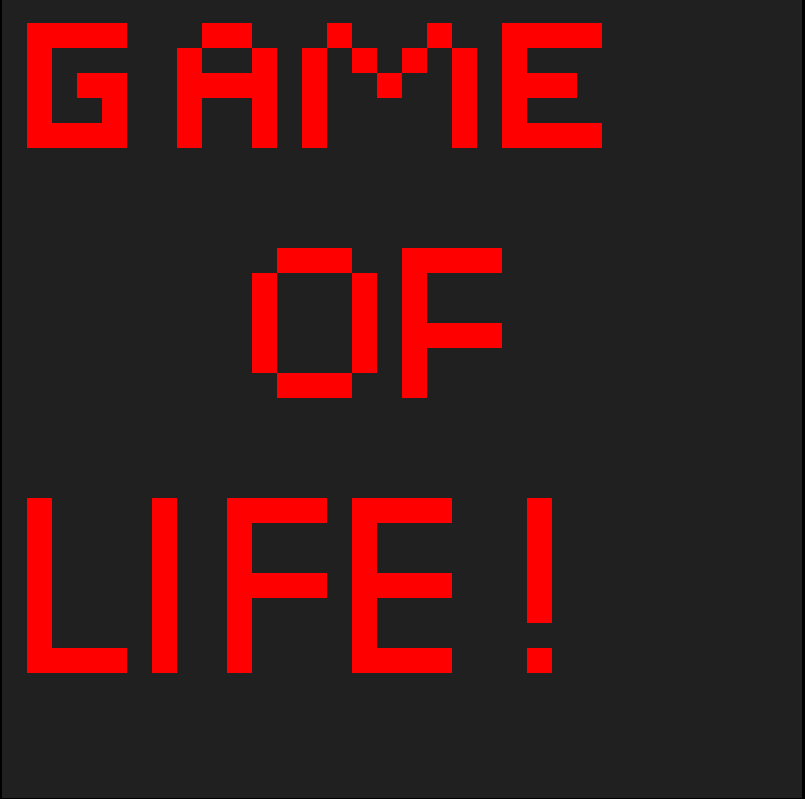

# CELL-AUTOMATA
Implementation of conway's game of life.

## RULES
Alive cells stay alive if they have 2 or 3 neighbors. 
Otherwise they die.

Dead cells turn alive if they have exactly 3 neighbors.

## CONTROLS
- **Paint tool:** pick Draw or Erase, then click and drag on the board to paint cells.
- **Grid size:** slider from 16 to 128 cells per side. Changing it clears the board.
- **Play / Pause:** start and stop the simulation.
- **Reset:** clear the board.

## BUILD
npm i

open index.html with favorite browser.

To recompile `index.ts` into `index.js` while editing:

npm run watch

## FONTS
The page uses [Press Start 2P](https://fonts.google.com/specimen/Press+Start+2P) for the title and [Inter](https://fonts.google.com/specimen/Inter) for everything else, both loaded from Google Fonts. Offline, it falls back to your system fonts.

## TODO
Ability to add image as start
